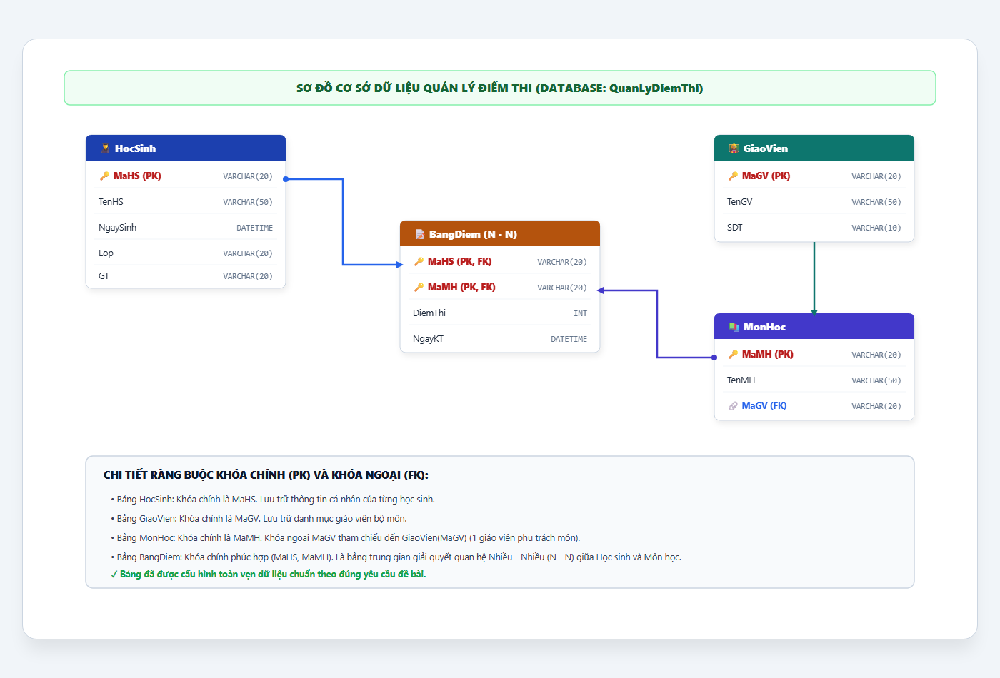
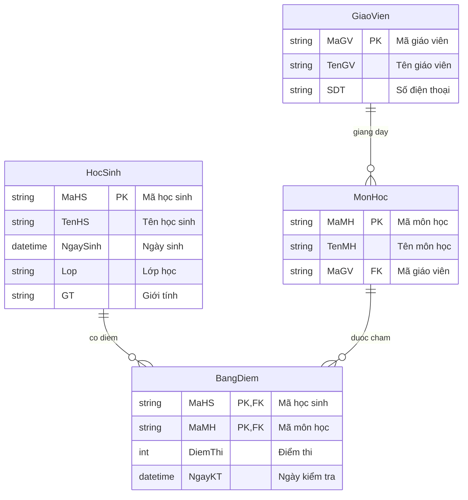

# [BÀI TẬP] TẠO BẢNG TRONG CƠ SỞ DỮ LIỆU BẰNG CÂU LỆNH SQL

- **Mục tiêu:** Tạo được bảng trong CSDL bằng câu lệnh SQL với đầy đủ khóa chính (Primary Key) và khóa ngoại (Foreign Key) tạo liên kết giữa các bảng.
- **Tên CSDL:** `QuanLyDiemThi`
- **Sinh viên thực hiện:** DTC245200413 (`dtc245200413-cmyk`)
- **Repository:** [https://github.com/dtc245200413-cmyk/jwbd-2023-sql-create-table](https://github.com/dtc245200413-cmyk/jwbd-2023-sql-create-table)
- **Mã nguồn tham khảo:** [https://github.com/codegym-vn/jwbd-2023-sql-create-table](https://github.com/codegym-vn/jwbd-2023-sql-create-table) (nhánh `dev`)

---

## 1. MÔ TẢ CÁC BẢNG TRONG CƠ SỞ DỮ LIỆU

Hệ thống quản lý điểm thi gồm 4 bảng dữ liệu:

### Bảng 1: `HocSinh`
| STT | Tên trường | Kiểu dữ liệu | Độ dài | Ràng buộc | Ý nghĩa |
|:---:|:---|:---|:---:|:---|:---|
| 1 | `MaHS` | VARCHAR | 20 | **PRIMARY KEY** | Mã định danh học sinh |
| 2 | `TenHS` | VARCHAR | 50 | | Họ và tên học sinh |
| 3 | `NgaySinh` | DATETIME | | | Ngày tháng năm sinh |
| 4 | `Lop` | VARCHAR | 20 | | Lớp học |
| 5 | `GT` | VARCHAR | 20 | | Giới tính |

### Bảng 2: `GiaoVien`
| STT | Tên trường | Kiểu dữ liệu | Độ dài | Ràng buộc | Ý nghĩa |
|:---:|:---|:---|:---:|:---|:---|
| 1 | `MaGV` | VARCHAR | 20 | **PRIMARY KEY** | Mã định danh giáo viên |
| 2 | `TenGV` | VARCHAR | 50 | | Họ và tên giáo viên |
| 3 | `SDT` | VARCHAR | 10 | | Số điện thoại liên hệ |

### Bảng 3: `MonHoc`
| STT | Tên trường | Kiểu dữ liệu | Độ dài | Ràng buộc | Ý nghĩa |
|:---:|:---|:---|:---:|:---|:---|
| 1 | `MaMH` | VARCHAR | 20 | **PRIMARY KEY** | Mã môn học |
| 2 | `TenMH` | VARCHAR | 50 | | Tên môn học |
| 3 | `MaGV` | VARCHAR | 20 | **FOREIGN KEY** | Tham chiếu đến `GiaoVien(MaGV)` |

### Bảng 4: `BangDiem` *(Bảng trung gian quan hệ N - N giữa HocSinh & MonHoc)*
| STT | Tên trường | Kiểu dữ liệu | Độ dài | Ràng buộc | Ý nghĩa |
|:---:|:---|:---|:---:|:---|:---|
| 1 | `MaHS` | VARCHAR | 20 | **PK, FK** | Tham chiếu đến `HocSinh(MaHS)` |
| 2 | `MaMH` | VARCHAR | 20 | **PK, FK** | Tham chiếu đến `MonHoc(MaMH)` |
| 3 | `DiemThi` | INT | | | Điểm thi kết thúc môn |
| 4 | `NgayKT` | DATETIME | | | Ngày kiểm tra / thi |

---

## 2. SƠ ĐỒ MÔ HÌNH QUAN HỆ (ERD DIAGRAM)



### Sơ đồ quan hệ dạng Mermaid:


---

## 3. CÁC BƯỚC THỰC HIỆN BẰNG CÂU LỆNH SQL

### Bước 1: Tạo cơ sở dữ liệu `QuanLyDiemThi`
```sql
CREATE DATABASE QuanLyDiemThi;
```

### Bước 2: Chọn Database `QuanLyDiemThi` để làm việc
```sql
USE QuanLyDiemThi;
```

### Bước 3: Tạo bảng `HocSinh`
```sql
CREATE TABLE HocSinh(
    MaHS VARCHAR(20) PRIMARY KEY,
    TenHS VARCHAR(50),
    NgaySinh DATETIME,
    Lop VARCHAR(20),
    GT VARCHAR(20)
);
```

### Bước 4: Tạo bảng `MonHoc`
```sql
CREATE TABLE MonHoc(
    MaMH VARCHAR(20) PRIMARY KEY,
    TenMH VARCHAR(50),
    MaGV VARCHAR(20)
);
```

### Bước 5: Tạo bảng trung gian `BangDiem`
Bảng `BangDiem` giải quyết mối quan hệ Nhiều - Nhiều ($N - N$) giữa học sinh và môn học:
```sql
CREATE TABLE BangDiem(
    MaHS VARCHAR(20),
    MaMH VARCHAR(20),
    DiemThi INT,
    NgayKT DATETIME,
    PRIMARY KEY (MaHS, MaMH),
    FOREIGN KEY (MaHS) REFERENCES HocSinh(MaHS),
    FOREIGN KEY (MaMH) REFERENCES MonHoc(MaMH)
);
```

### Bước 6: Tạo bảng `GiaoVien`
```sql
CREATE TABLE GiaoVien(
    MaGV VARCHAR(20) PRIMARY KEY,
    TenGV VARCHAR(50),
    SDT VARCHAR(10)
);
```

### Bước 7: Bổ sung khóa ngoại `FK_MaGV` cho bảng `MonHoc`
```sql
ALTER TABLE MonHoc ADD CONSTRAINT FK_MaGV FOREIGN KEY (MaGV) REFERENCES GiaoVien(MaGV);
```

---

## 4. TỆP MÃ NGUỒN SQL HOÀN CHỈNH
Mã nguồn SQL đầy đủ bao gồm câu lệnh tạo bảng và dữ liệu mẫu kiểm chứng có sẵn tại:
👉 [`create-table.sql`](create-table.sql)

---

## 5. LINK NỘP BÀI
- **GitHub Repository:** [https://github.com/dtc245200413-cmyk/jwbd-2023-sql-create-table](https://github.com/dtc245200413-cmyk/jwbd-2023-sql-create-table)
